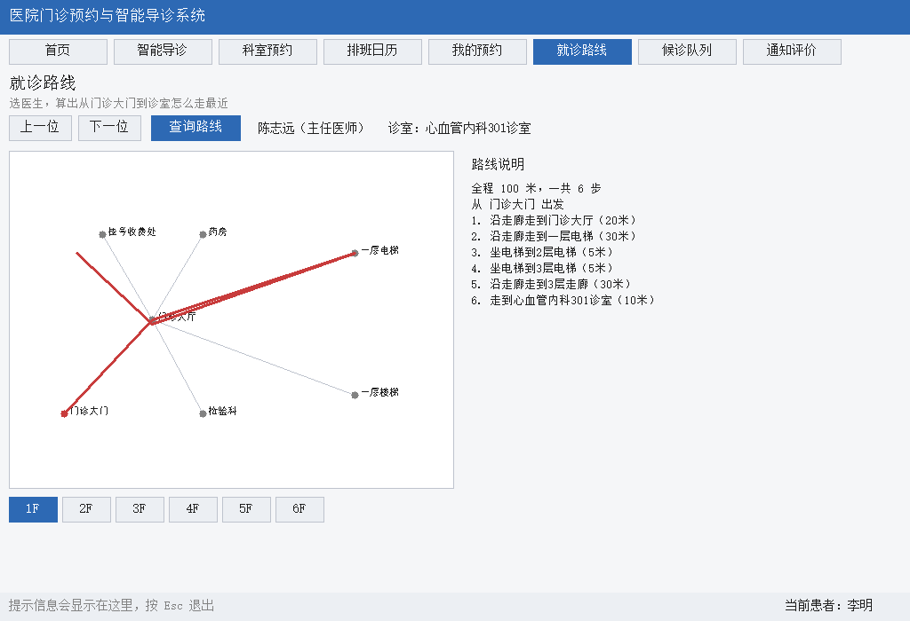

# 医院门诊预约与智能导诊系统

> 数据结构课程设计 · 第 1 题
> 姓名：张健维　学号：24070213
> 语言：C++　图形界面：EasyX

---

## 一、这个程序能做什么

模拟一个医院的门诊系统，主要功能：

**基本功能**

- **智能导诊**：输入自己哪里不舒服（比如"最近胸闷心悸，还有点气短"），系统推荐该挂哪个科室，并给出匹配度
- **科室预约**：按科室看医生，选一个有余号的时段挂号
- **排班日历**：用日历的形式显示医生一周的出诊安排
- **我的预约**：查看自己的预约记录、看预约凭证、取消预约、签到候诊
- **就诊路线**：选一个目标医生，算出从门诊大门过去怎么走，给出文字说明
- **医生查询**：按科室看医生，能看到职称、擅长、评分、挂号费、诊室

**扩展功能**

- **候诊队列**：签到后进入队列，支持叫号、过号、完成就诊，**老年人自动优先**
- **停诊自动通知**：医生临时停诊时自动帮患者退号、退号源，并给每位患者发通知
- **患者评价**：看完病给医生打 1~5 星，评分会影响导诊推荐
- **转诊推荐**：某科室号源紧张时，用余弦相似度推荐相近而且有号的科室

---

## 二、界面截图

| 首页 | 智能导诊 |
|---|---|
|  |  |

| 科室预约 | 排班日历 |
|---|---|
|  |  |

| 我的预约 | 就诊路线 |
|---|---|
|  |  |

| 候诊队列 | 通知与评价 |
|---|---|
|  |  |

停诊自动通知：


---

## 三、怎么编译和运行

### 环境要求

- Windows 系统
- TDM-GCC 或者其它 MinGW-w64 的 g++ 编译器
- **EasyX 图形库**（官网 https://easyx.cn 可以下载）

### 编译

双击 `build.bat`，或者在命令行里执行：

```
build.bat
```

编译成功后会生成 `build\hospital.exe`。

### 运行

**最简单的办法：双击 `run.bat`**，它会自动编译（如果还没编译过）然后启动程序。

也可以在命令行里手动运行：

```
build\hospital.exe
```

> **注意**：程序要读 `data` 文件夹，所以最好在项目根目录下运行。
> 如果直接双击 `build\hospital.exe` 也可以——程序找不到 `data\` 时会自动往上一层找 `..\data\`。

### 怎么操作

| 操作 | 效果 |
|---|---|
| 点顶部的标签 | 切换页面 |
| 鼠标点击 | 点按钮、点列表、点日历格子 |
| `Esc` | 退出程序 |

---

## 四、文件说明

### 源代码（6 个文件）

| 文件 | 行数 | 作用 |
|---|---|---|
| `src/structs.h` | 229 | 公共头文件：所有结构体、常量、全局变量和函数声明 |
| `src/data.cpp` | 517 | 读数据文件、日期计算、查找和统计 |
| `src/graph.cpp` | 141 | 平面图（邻接矩阵）和最短路算法（Dijkstra） |
| `src/logic.cpp` | 515 | 业务功能：导诊、预约、候诊队列、停诊通知、评价、转诊 |
| `src/ui.cpp` | 1024 | 图形界面：8 个页面的绘制和点击处理（极简风格） |
| `src/main.cpp` | 51 | 主函数：读数据 → 开界面 |

合计 **2477 行**（其中代码约 2000 行，其余是空行和注释）。

### 编译运行脚本

| 文件 | 作用 |
|---|---|
| `build.bat` | 一键编译，生成 `build\hospital.exe` |
| `run.bat` | 一键编译并运行（没编译过会先自动编译） |

> 每个文件里有哪些函数、老师可能问什么，都写在 **[docs/各文件说明.md](docs/各文件说明.md)** 里。

### 数据文件（8 个 txt）

都在 `data/` 目录下，用 `|` 分隔字段，`#` 开头的是注释。

| 文件 | 内容 | 条数 |
|---|---|---|
| `department.txt` | 科室 | 12 |
| `doctor.txt` | 医生 | 36 |
| `schedule.txt` | 排班 | 264 |
| `patient.txt` | 患者 | 10 |
| `appointment.txt` | 预约记录 | 28 |
| `evaluation.txt` | 评价 | 20 |
| `symptom.txt` | 症状和科室的关联 | 80 |
| `map.txt` | 就诊楼平面图（N=节点 L=边） | 58 节点 62 边 |

> 日期写成 `TODAY`、`TODAY+1` 这种形式，程序会自动换成真实的今天/明天，
> 这样测试数据不会因为放久了就过期。

### 文档

| 文件 | 内容 |
|---|---|
| `docs/需求分析.md` | 需求分析（第一次中期检查要交的） |
| `docs/数据结构设计.md` | 数据结构设计和算法说明 |
| `docs/各文件说明.md` | **每个源文件干什么，老师可能问什么**（答辩用） |
| `docs/git版本说明.md` | **每次提交加了什么、三个版本分别包含什么** |
| `docs/开发日志.md` | 开发过程、遇到的问题、两个中期检查版本说明 |
| `docs/截图/` | 9 张界面截图 |

---

## 五、用到的数据结构和算法

| 数据结构/算法 | 用在哪 |
|---|---|
| 数组（顺序表） | 存科室、医生、排班、预约等所有数据 |
| 邻接矩阵 | 就诊楼平面图 |
| 有序数组（优先队列） | 候诊队列，按优先级插入 |
| 二维数组 | 排班日历的表格 |
| 加权二部图 | 症状和科室的关联，用于智能导诊 |
| 简单字符串匹配 | 从症状描述里找出症状关键词 |
| Dijkstra 最短路 | 就诊路线查询 |
| 余弦相似度 | 科室相似度，用于转诊推荐 |
| 选择排序 | 导诊结果排序、转诊推荐排序 |
| 顺序查找 | 按编号找科室、医生、排班 |

> 没有用 STL，也没有用模板，这些都是自己写的。

---

## 六、版本标签

| 标签 | 对应 | 内容 |
|---|---|---|
| `v0.1-midterm1` | 第 1 次中期检查（第 6 周） | 需求分析、数据结构设计文档 + 结构体定义 + 读数据 + 平面图和最短路 + 全部业务功能函数 |
| `v0.2-midterm2` | 第 2 次中期检查（第 11 周） | 所有业务功能 + 图形界面，程序可以完整演示 |
| `v1.0-final` | 最终验收（第 15 周） | 补上说明文档和截图，修好数据文件夹的路径问题，加上 `run.bat` |

```
git log --oneline --decorate     看提交记录和标签
git checkout v0.2-midterm2       切到第二次中期检查的版本
```
